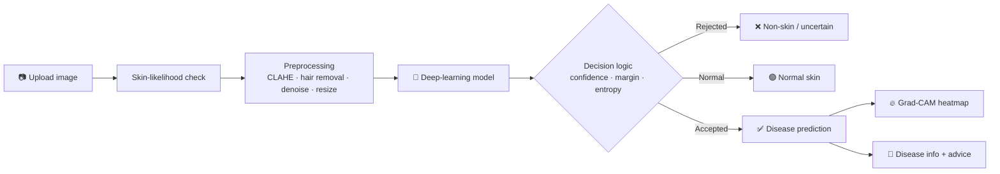
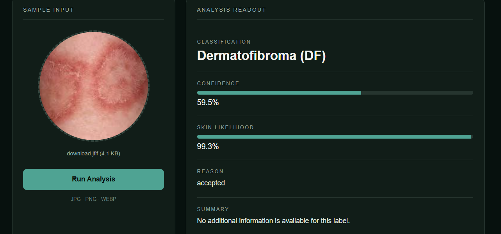
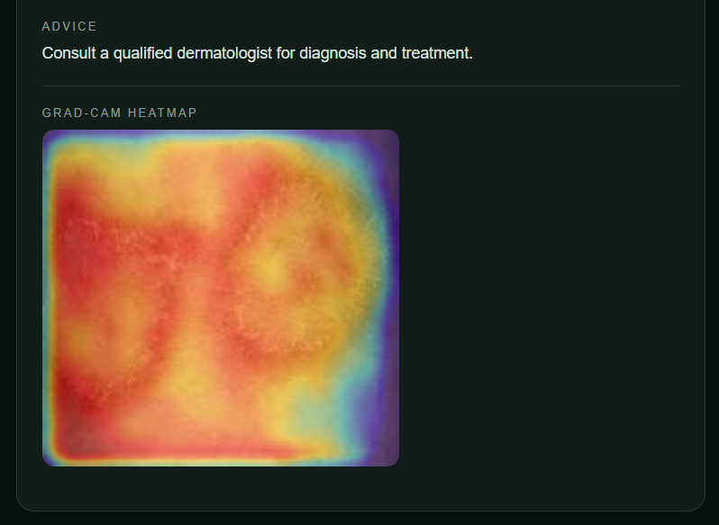

<div align="center">

# 🩺 Skin Disease AI

### Deep-learning skin image classification with explainable Grad-CAM heatmaps


**Upload a skin image → get a prediction, a confidence score, disease information and a heatmap showing *why* the model decided that.**

</div>

---

> ⚠️ **Medical disclaimer:** This project is built for **research and educational purposes only**.
> It is **not** a medical device and must **not** be used for diagnosis or treatment decisions.
> Always consult a qualified dermatologist.

---

## 📑 Table of Contents

1. [Overview](#-overview)
2. [Key Features](#-key-features)
3. [How It Works](#-how-it-works)
4. [Screenshots](#-screenshots)
5. [Tech Stack](#-tech-stack)
6. [Project Structure](#-project-structure)
7. [Getting Started](#-getting-started)
8. [Usage](#-usage)
9. [API Reference](#-api-reference)
10. [Configuration](#-configuration)
11. [Model Details](#-model-details)
12. [Limitations](#-limitations)
13. [Future Improvements](#-future-improvements)
14. [Author](#-author)

---

## 🔎 Overview

**Skin Disease AI** is an end-to-end web application that classifies skin images using a trained deep-learning model.
It combines a **FastAPI** backend, a clean **web interface**, and **Grad-CAM** explainability so users can see which region of the image influenced the prediction.

The system does not blindly trust the model. A built-in **rejection pipeline** checks whether the uploaded picture is actually skin and whether the model is confident enough, so unrelated or unclear images are flagged instead of receiving a wrong disease label.

---

## ✨ Key Features

| Feature | Description |
|---|---|
| 🧠 **Disease classification** | Predicts the most likely skin condition and returns the top-K predictions with confidence scores |
| 🔥 **Grad-CAM heatmap** | Visual explanation highlighting the image regions that drove the prediction |
| 🛡️ **Smart rejection** | Rejects non-skin images and uncertain predictions using skin-likelihood, confidence, margin and entropy checks |
| 🟢 **Normal-skin handling** | Recognises normal/healthy skin results and avoids unnecessary heatmaps |
| 📖 **Disease information** | Each prediction comes with a description and advice text |
| 🖼️ **Modern web UI** | Drag-and-drop upload, live preview, confidence bars and a results panel |
| 📝 **Prediction logging** | Every request is saved to a JSON Lines log for later review |
| 🔌 **REST API** | Interactive Swagger documentation at `/docs` |
| 🪟 **One-click start** | `run.bat` launches the whole project on Windows |

---

## ⚙️ How It Works



1. **Upload:** the image is read and its orientation is corrected.
2. **Skin check:** a skin-likelihood score is computed from the image.
3. **Preprocessing:** optional contrast enhancement (CLAHE), hair removal and denoising, then resize to the model input size.
4. **Prediction:** the model outputs class probabilities.
5. **Decision:** the rejection logic accepts, rejects, or marks the image as normal skin.
6. **Explanation:** for accepted results, Grad-CAM produces a heatmap overlay.

---

## 📸 Screenshots

> Add your own screenshots to a `docs/` folder and they will show up here.

| Upload & Result | Grad-CAM Heatmap |
|---|---|
|  |  |

---

## 🧰 Tech Stack

- **Language:** Python 3.11
- **Backend:** FastAPI, Uvicorn
- **Deep learning:** PyTorch, Torchvision
- **Image processing:** OpenCV, Pillow, NumPy
- **Explainability:** Grad-CAM (custom implementation)
- **Frontend:** HTML, CSS, vanilla JavaScript
- **Config:** YAML
- **Logging:** JSON Lines

---

## 📂 Project Structure

```
skin_d-main/
├── configs/
│   └── default.yaml            # Preprocessing settings (CLAHE, hair removal, image size)
├── frontend/
│   └── index.html              # Web interface
├── models/
│   └── best.pt                 # Trained model (not included in the repo)
├── src/
│   └── skin_disease_ai/
│       ├── api/
│       │   ├── main.py         # FastAPI app and endpoints
│       │   ├── rejection.py    # Skin check and accept/reject logic
│       │   └── storage.py      # Prediction logger
│       ├── data/
│       │   └── preprocessing.py  # Image preprocessing and transforms
│       ├── models/             # Model loading from checkpoint
│       ├── utils/              # Device selection, checkpoint loading
│       ├── xai/
│       │   └── gradcam.py      # Grad-CAM implementation
│       ├── config.py           # YAML config loader
│       └── disease_info.py     # Disease descriptions and advice
├── logs/                       # Prediction logs (ignored by Git)
├── requirements.txt
├── run.bat                     # One-click launcher (Windows)
└── README.md
```

---

## 🚀 Getting Started

### Prerequisites
- Windows with **Python 3.11**
- The trained model file `best.pt`

### 1. Clone the repository
```bash
git clone https://github.com/Samarth7272/derma_scans.git
cd derma_scans
git checkout clean-main
```

### 2. Create a virtual environment and install packages
```bash
py -3.11 -m venv .venv
.venv\Scripts\activate
pip install -r requirements.txt
```

### 3. Add the model
The trained weights are too large for GitHub. Put your model file here:
```
models/best.pt
```

### 4. Run the project

**Easiest:** double-click **`run.bat`**

**Or manually:**
```bash
set PYTHONPATH=src
set CHECKPOINT_PATH=models\best.pt
set CONFIG_PATH=configs\default.yaml
python -m uvicorn skin_disease_ai.api.main:app
```

Wait for `Application startup complete`, then open:

| Page | URL |
|---|---|
| 🖥️ Web app | http://127.0.0.1:8000/ui/ |
| 📚 API docs (Swagger) | http://127.0.0.1:8000/docs |
| ❤️ Health check | http://127.0.0.1:8000/health |

---

## 🕹️ Usage

1. Open **http://127.0.0.1:8000/ui/**
2. Click the circle (or drag and drop) to upload a skin image
3. Press **Run Analysis**
4. Read the result:
   - **Classification** and **confidence**
   - **Skin likelihood**
   - **Reason** (accepted, rejected, or normal)
   - **Summary** and **advice** for the predicted condition
   - **Grad-CAM heatmap** (red/yellow areas influenced the decision most)

> The first request can take several seconds on a CPU, especially with Grad-CAM enabled.

---

## 🔌 API Reference

| Method | Endpoint | Description |
|---|---|---|
| `GET` | `/` | Service status message |
| `GET` | `/health` | Model-loaded and logger status |
| `GET` | `/classes` | List of classes the model can predict |
| `POST` | `/predict` | Classify an uploaded image |
| `GET` | `/ui/` | Web interface |

### `POST /predict`

**Query parameters**

| Parameter | Default | Description |
|---|---|---|
| `topk` | `5` | Number of top predictions to return |
| `gradcam` | `true` | Include a Grad-CAM heatmap |

**Body:** `multipart/form-data` with a `file` field containing the image.

**Example**
```bash
curl -X POST "http://127.0.0.1:8000/predict?topk=5&gradcam=true" \
     -F "file=@sample.jpg"
```

**Response (abridged)**
```json
{
  "request_id": "cbbf994a-a799-4bd7-8227-1c46396641ea",
  "status": "accepted",
  "is_rejected": false,
  "reason": "accepted",
  "skin_likelihood": 0.99,
  "confidence": 0.59,
  "margin": 0.23,
  "entropy": 0.24,
  "predicted_class": "Dermatofibroma (DF)",
  "display_label": "Dermatofibroma (DF)",
  "predictions": [
    {
      "class_name": "Dermatofibroma (DF)",
      "confidence": 0.59,
      "disease_info": { "description": "...", "advice": "..." }
    }
  ],
  "gradcam_jpeg_base64": "/9j/4AAQSkZJRg..."
}
```

---

## 🎛️ Configuration

### `configs/default.yaml`
```yaml
data:
  apply_clahe: true     # contrast enhancement
  remove_hair: true     # hair artefact removal
  denoise: false
  image_size: 224
```

> Keep these preprocessing options the same as the ones used during training.

### Environment variables

| Variable | Default | Purpose |
|---|---|---|
| `CHECKPOINT_PATH` | `models/best.pt` | Path to the trained model |
| `CONFIG_PATH` | `configs/default.yaml` | Path to the config file |
| `MIN_SKIN_LIKELIHOOD` | `0.03` | Minimum skin score to accept an image |
| `REJECT_CONFIDENCE_THRESHOLD` | `0.30` | Below this confidence the image is rejected |
| `NORMAL_CONFIDENCE_THRESHOLD` | `0.18` | Threshold for the normal-skin fallback |
| `ENTROPY_REJECT_THRESHOLD` | `0.93` | Reject when the prediction is too uncertain |
| `ENABLE_NORMAL_FALLBACK` | `true` | Enable normal-skin fallback logic |
| `CORS_ALLOW_ORIGINS` | `*` | Allowed browser origins |
| `PREDICTION_LOG_PATH` | `logs/predictions.jsonl` | Where predictions are logged |

---

## 🧠 Model Details

Fill in the details of your own training run:

| Item | Value |
|---|---|
| Architecture | _e.g. ResNet / EfficientNet_ |
| Dataset | _name and number of images_ |
| Number of classes | _see `/classes`_ |
| Input size | 224 × 224 |
| Accuracy / F1 | _add your results_ |

---

## ⚠️ Limitations

- Predictions are only as good as the training data; unusual lighting, skin tones or image quality can reduce accuracy.
- The model only knows the classes it was trained on.
- Confidence scores are not clinical probabilities.
- Not validated for clinical use.

---

## 🔮 Future Improvements

- Deploy online (Render / Hugging Face Spaces)
- Add more disease classes and a larger, more diverse dataset
- Multi-language disease information
- User accounts and a history dashboard
- Mobile-friendly camera capture
- Model calibration and uncertainty estimation

---

## 👤 Author

**Samarth Shukla**
B.Tech Computer Science & Engineering
GitHub: [@Samarth7272](https://github.com/Samarth7272)

---

<div align="center">

⭐ If you found this project useful, consider giving it a star.

*Built for learning and research. Not for medical use.*

</div>