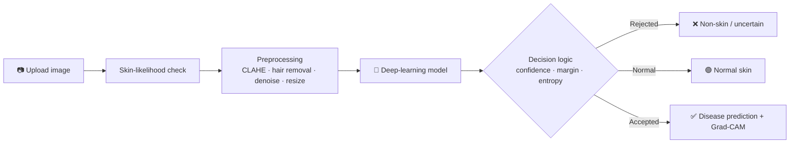

<div align="center">

# 🩺 Skin Disease AI

### Deep-Learning Skin Image Classification with Explainable Grad-CAM Heatmaps

*Upload a skin image and get a prediction, a confidence score, disease information and a heatmap showing **why** the model decided that. A built-in rejection pipeline refuses non-skin and uncertain images instead of guessing.*


[📧 Hire Me](mailto:samarthworldwide@gmail.com) · [💼 LinkedIn](https://www.linkedin.com/in/samarth-shukla-b72003293) · [🐙 GitHub](https://github.com/Samarth7272)

</div>

> ⚠️ **Medical disclaimer:** This project is built for **research and educational purposes only**. It is **not** a medical device and must **not** be used for diagnosis or treatment decisions. Always consult a qualified dermatologist.

---

## 📌 TL;DR (for recruiters)

- **What:** An end-to-end skin disease classifier: image upload → validation → deep-learning prediction → explainable Grad-CAM heatmap, served through a FastAPI backend and a web UI.
- **Why it matters:** It goes beyond "train a model". It covers preprocessing, input validation, uncertainty-aware rejection, explainability, a REST API, logging and a usable frontend.
- **Deliberate design:** The system does not blindly trust the model. Skin-likelihood, confidence, margin and entropy checks reject unrelated or unclear images rather than returning a wrong label.
- **Stack:** Python 3.11 · PyTorch · FastAPI · OpenCV · Grad-CAM (custom implementation) · HTML/CSS/JS.
- **Try it in 2 minutes:** Clone, add the model file, double-click `run.bat`, and open the web app. See [Getting Started](#-getting-started).

---

## 📸 Screenshots

### 1. Upload and classification


### 2. Confidence, skin likelihood, reason and advice


### 3. Grad-CAM explainability heatmap


> The app labels every result as research-only and recommends consulting a qualified dermatologist.

---

## 📑 Table of Contents

1. [The Problem](#-the-problem)
2. [Key Features](#-key-features)
3. [How It Works](#️-how-it-works)
4. [Results at a Glance](#-results-at-a-glance)
5. [Design Decisions](#-design-decisions)
6. [Tech Stack](#-tech-stack)
7. [Project Structure](#-project-structure)
8. [Getting Started](#-getting-started)
9. [Usage](#️-usage)
10. [API Reference](#-api-reference)
11. [Configuration](#️-configuration)
12. [Model Details](#-model-details)
13. [Skills Demonstrated](#-skills-demonstrated)
14. [Limitations](#️-limitations)
15. [Future Improvements](#-future-improvements)
16. [About the Author](#-about-the-author)

---

## 🎯 The Problem

Most image classifiers always return an answer, even for a photo of a cat or a blurry, uncertain image. In a medical context, a confident wrong label is worse than no label. Black-box predictions also give users no way to see what the model is looking at.

**Skin Disease AI** treats this as a trust problem. It validates the input, rejects what it cannot classify reliably, and explains every accepted prediction with a visual heatmap.

---

## ✨ Key Features

| Feature | Description |
|---|---|
| 🧠 **Disease classification** | Predicts the most likely skin condition and returns top-K predictions with confidence scores |
| 🔥 **Grad-CAM heatmap** | Visual explanation highlighting the image regions that drove the prediction |
| 🛡️ **Smart rejection** | Rejects non-skin images and uncertain predictions using skin-likelihood, confidence, margin and entropy checks |
| 🟢 **Normal-skin handling** | Recognises normal/healthy skin results and avoids unnecessary heatmaps |
| 📖 **Disease information** | Each prediction comes with a description and advice text |
| 🖼️ **Modern web UI** | Drag-and-drop upload, live preview, confidence bars and a results panel |
| 📝 **Prediction logging** | Every request is saved to a JSON Lines log for later review |
| 🔌 **REST API** | Interactive Swagger documentation at `/docs` |
| 🪟 **One-click start** | `run.bat` launches the whole project on Windows |

---

## ⚙️ How It Works



1. **Upload:** the image is read and its orientation is corrected.
2. **Skin check:** a skin-likelihood score is computed from the image.
3. **Preprocessing:** optional contrast enhancement (CLAHE), hair removal and denoising, then resize to the model input size.
4. **Prediction:** the model outputs class probabilities.
5. **Decision:** the rejection logic accepts, rejects, or marks the image as normal skin.
6. **Explanation:** for accepted results, Grad-CAM produces a heatmap overlay.

---

## 📊 Results at a Glance

Example from the screenshots above, using a dermoscopy image of a **Dermatofibroma (DF)** lesion:

| Output | Value |
|---|---|
| Classification | Dermatofibroma (DF) |
| Confidence | 59.5% |
| Skin likelihood | 99.3% |
| Decision | `accepted` |
| Explanation | Grad-CAM heatmap (red/yellow = most influential regions) |

Every response also includes the **margin**, **entropy**, top-K predictions, disease description and advice. See the [API Reference](#-api-reference).

---

## 🧠 Design Decisions

- **Reject instead of guess:** A skin-likelihood gate plus confidence, margin and entropy thresholds stop the model from labelling photos that are not skin or are too uncertain. This is a safety-first choice for a medical-style use case.
- **Explainability by default:** A custom Grad-CAM implementation shows which regions drove each accepted prediction, so users and reviewers can sanity-check the model.
- **Config-driven preprocessing:** CLAHE, hair removal, denoising and image size live in `configs/default.yaml`. They must match training, so they are kept out of the code.
- **Tunable thresholds:** All rejection thresholds are environment variables, so behaviour can be adjusted without code changes.
- **Auditability:** Every request gets a `request_id` and is logged to JSON Lines, which makes failures easy to trace and review.
- **Separation of concerns:** API, rejection logic, preprocessing, model loading, explainability and disease info are separate modules.
- **Responsible framing:** Disclaimers appear in the README and in the UI footer, and the advice always points users to a dermatologist.

---

## 🧰 Tech Stack

| Area | Technology |
|---|---|
| **Language** | Python 3.11 |
| **Backend** | FastAPI, Uvicorn |
| **Deep learning** | PyTorch, Torchvision |
| **Image processing** | OpenCV, Pillow, NumPy |
| **Explainability** | Grad-CAM (custom implementation) |
| **Frontend** | HTML, CSS, vanilla JavaScript |
| **Config** | YAML |
| **Logging** | JSON Lines |

---

## 📂 Project Structure

```
derma_scans/
├── configs/
│   └── default.yaml            # Preprocessing settings (CLAHE, hair removal, ...)
├── docs/                       # README screenshots
├── frontend/
│   └── index.html              # Web interface
├── models/
│   └── best.pt                 # Trained model (not included in the repo)
├── src/
│   └── skin_disease_ai/
│       ├── api/
│       │   ├── main.py         # FastAPI app and endpoints
│       │   ├── rejection.py    # Skin check and accept/reject logic
│       │   └── storage.py      # Prediction logger
│       ├── data/
│       │   └── preprocessing.py  # Image preprocessing and transforms
│       ├── models/             # Model loading from checkpoint
│       ├── utils/              # Device selection, checkpoint loading
│       ├── xai/
│       │   └── gradcam.py      # Grad-CAM implementation
│       ├── config.py           # YAML config loader
│       └── disease_info.py     # Disease descriptions and advice
├── logs/                       # Prediction logs (ignored by Git)
├── requirements.txt
├── run.bat                     # One-click launcher (Windows)
└── README.md
```

---

## 🚀 Getting Started

### Prerequisites

- Windows with **Python 3.11**
- The trained model file `best.pt`

### 1. Clone the repository

```bash
git clone https://github.com/Samarth7272/derma_scans.git
cd derma_scans
git checkout clean-main
```

### 2. Create a virtual environment and install packages

```bash
py -3.11 -m venv .venv
.venv\Scripts\activate
pip install -r requirements.txt
```

### 3. Add the model

The trained weights are too large for GitHub. Put your model file here:

```
models/best.pt
```

### 4. Run the project

**Easiest:** double-click `run.bat`

**Or manually:**

```bash
set PYTHONPATH=src
set CHECKPOINT_PATH=models\best.pt
set CONFIG_PATH=configs\default.yaml
python -m uvicorn skin_disease_ai.api.main:app
```

Wait for `Application startup complete`, then open:

| Page | URL |
|---|---|
| 🖥️ Web app | http://127.0.0.1:8000/ui/ |
| 📚 API docs (Swagger) | http://127.0.0.1:8000/docs |
| ❤️ Health check | http://127.0.0.1:8000/health |

---

## 🕹️ Usage

1. Open http://127.0.0.1:8000/ui/
2. Click the circle (or drag and drop) to upload a skin image (JPG, PNG or WEBP).
3. Press **Run Analysis**.
4. Read the result:
   - **Classification** and **confidence**
   - **Skin likelihood**
   - **Reason** (accepted, rejected, or normal)
   - **Summary** and **advice** for the predicted condition
   - **Grad-CAM heatmap** (red/yellow areas influenced the decision most)

> The first request can take several seconds on a CPU, especially with Grad-CAM enabled.

---

## 🔌 API Reference

| Method | Endpoint | Description |
|---|---|---|
| `GET` | `/` | Service status message |
| `GET` | `/health` | Model-loaded and logger status |
| `GET` | `/classes` | List of classes the model can predict |
| `POST` | `/predict` | Classify an uploaded image |
| `GET` | `/ui/` | Web interface |

### `POST /predict`

**Query parameters**

| Parameter | Default | Description |
|---|---|---|
| `topk` | `5` | Number of top predictions to return |
| `gradcam` | `true` | Include a Grad-CAM heatmap |

**Body:** `multipart/form-data` with a `file` field containing the image.

**Example**

```bash
curl -X POST "http://127.0.0.1:8000/predict?topk=5&gradcam=true" \
     -F "file=@sample.jpg"
```

**Response (abridged)**

```json
{
  "request_id": "cbbf994a-a799-4bd7-8227-1c46396641ea",
  "status": "accepted",
  "is_rejected": false,
  "reason": "accepted",
  "skin_likelihood": 0.99,
  "confidence": 0.59,
  "margin": 0.23,
  "entropy": 0.24,
  "predicted_class": "Dermatofibroma (DF)",
  "display_label": "Dermatofibroma (DF)",
  "predictions": [
    {
      "class_name": "Dermatofibroma (DF)",
      "confidence": 0.59,
      "disease_info": { "description": "...", "advice": "..." }
    }
  ],
  "gradcam_jpeg_base64": "/9j/4AAQSkZJRg..."
}
```

---

## 🎛️ Configuration

### `configs/default.yaml`

```yaml
data:
  apply_clahe: true     # contrast enhancement
  remove_hair: true     # hair artefact removal
  denoise: false
  image_size: 224
```

> Keep these preprocessing options the same as the ones used during training.

### Environment variables

| Variable | Default | Purpose |
|---|---|---|
| `CHECKPOINT_PATH` | `models/best.pt` | Path to the trained model |
| `CONFIG_PATH` | `configs/default.yaml` | Path to the config file |
| `MIN_SKIN_LIKELIHOOD` | `0.03` | Minimum skin score to accept an image |
| `REJECT_CONFIDENCE_THRESHOLD` | `0.30` | Below this confidence the image is rejected |
| `NORMAL_CONFIDENCE_THRESHOLD` | `0.18` | Threshold for the normal-skin fallback |
| `ENTROPY_REJECT_THRESHOLD` | `0.93` | Reject when the prediction is too uncertain |
| `ENABLE_NORMAL_FALLBACK` | `true` | Enable normal-skin fallback logic |
| `CORS_ALLOW_ORIGINS` | `*` | Allowed browser origins |
| `PREDICTION_LOG_PATH` | `logs/predictions.jsonl` | Where predictions are logged |

---

## 🧬 Model Details

<!-- TODO: add Architecture (e.g. ResNet / EfficientNet), Dataset name and size, number of classes, and Accuracy / F1 to this table. Recruiters look for these numbers. -->

| Item | Value |
|---|---|
| Framework | PyTorch |
| Input size | 224 × 224 |
| Preprocessing | CLAHE contrast enhancement, hair removal, resize |
| Explainability | Grad-CAM (custom implementation) |
| Classes | See the `/classes` endpoint |

---

## 🎓 Skills Demonstrated

- Training and deploying a **deep-learning image classifier** (PyTorch)
- **Explainable AI**: a custom Grad-CAM implementation
- **Uncertainty-aware inference**: rejection using confidence, margin and entropy
- **Computer vision preprocessing** with OpenCV (CLAHE, hair removal, denoising)
- **REST API design** with FastAPI and auto-generated Swagger docs
- **Configuration management** with YAML and environment variables
- A **frontend** with drag-and-drop upload and live results
- **Structured prediction logging** (JSON Lines)
- **Responsible AI practice**: clear disclaimers and documented limitations

---

## ⚠️ Limitations

- Predictions are only as good as the training data. Unusual lighting, skin tones or image quality can reduce accuracy.
- The model only knows the classes it was trained on.
- Confidence scores are not clinical probabilities.
- Not validated for clinical use.

---

## 🔮 Future Improvements

- [ ] 🌐 Deploy online (Render / Hugging Face Spaces)
- [ ] 🩻 Add more disease classes and a larger, more diverse dataset
- [ ] 📖 Richer disease descriptions for every class
- [ ] 🌍 Multi-language disease information
- [ ] 👤 User accounts and a history dashboard
- [ ] 📱 Mobile-friendly camera capture
- [ ] 🎯 Model calibration and uncertainty estimation
- [ ] 🐳 Docker image and 🧪 automated tests with CI

---

## 👨‍💻 About the Author

**Samarth Shukla** is a B.Tech Computer Science student and Software Engineer Intern at LV8, building AI-powered and full-stack applications.

**Skills:** Python · PyTorch · FastAPI · Scikit-learn · NLP · LangChain · Hugging Face · JavaScript/TypeScript · React/Next.js · SQL · Docker · AWS · Git

### 💼 Open to Opportunities

I'm actively looking for **AI/ML, Backend and Full-Stack** roles (full-time and internships). If this project caught your eye, I'd love to talk.

[


](mailto:samarthworldwide@gmail.com)
[


](https://www.linkedin.com/in/samarth-shukla-b72003293)
[


](https://github.com/Samarth7272)

---

<div align="center">

⭐ If you found this project useful, please give it a star!

*Built for learning and research. Not for medical use.*

</div>
